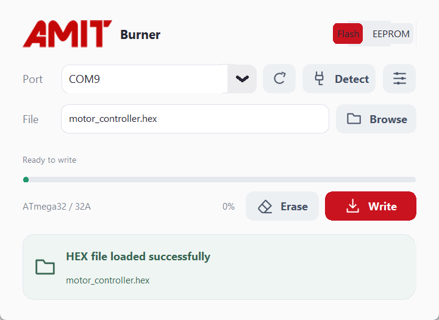
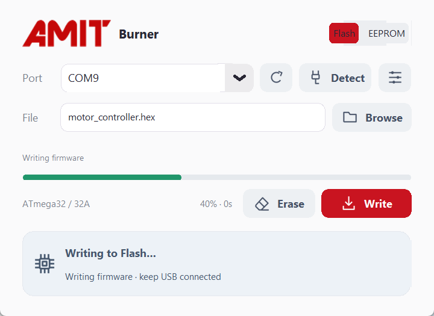
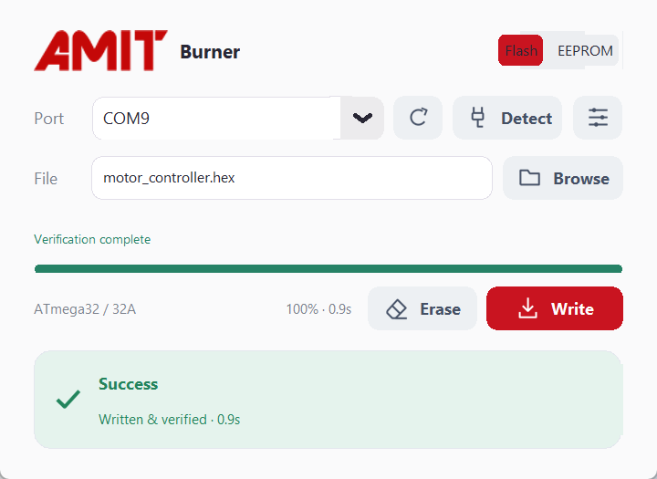

  

<h1 align="center">AMIT Burner</h1>

  <a href="https://github.com/FathiMandour/AMIT-Burner/releases">Downloads</a>
  &nbsp; · &nbsp;
  <a href="#how-to-use">How to use</a>
  &nbsp; · &nbsp;
  <a href="#preview">Preview</a>

  

## How to use

1. Open **AMIT Burner** and connect your kit.
2. Select your port, or click **Detect**.
3. Click **Browse** and choose your file.
4. Click **Write**. Keep the kit connected until the operation finishes.
5. When **Success** appears, follow the message in the application. Reset your kit if prompted.

## Preview

### Writing

  

### Complete

  

